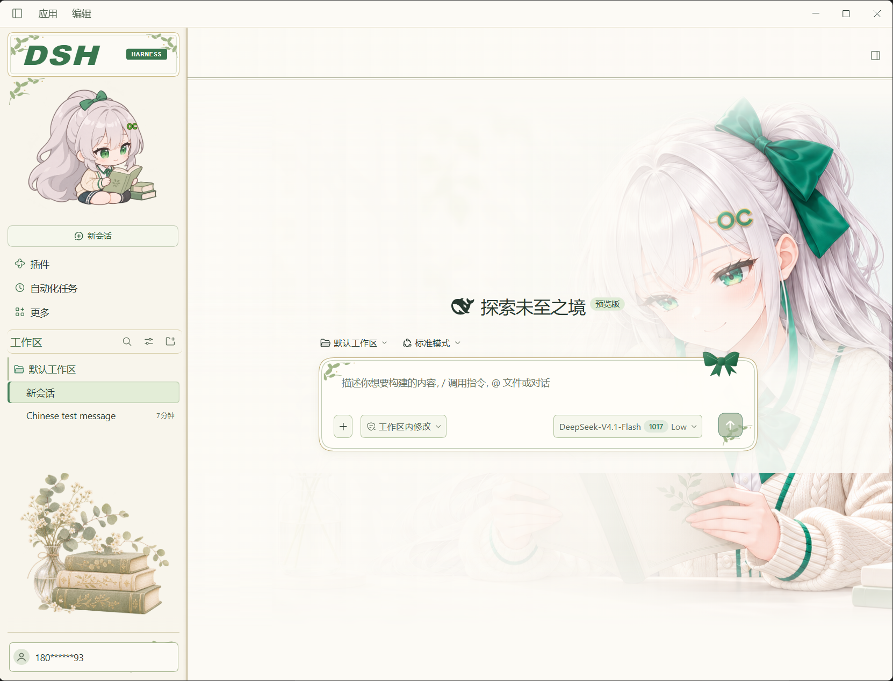
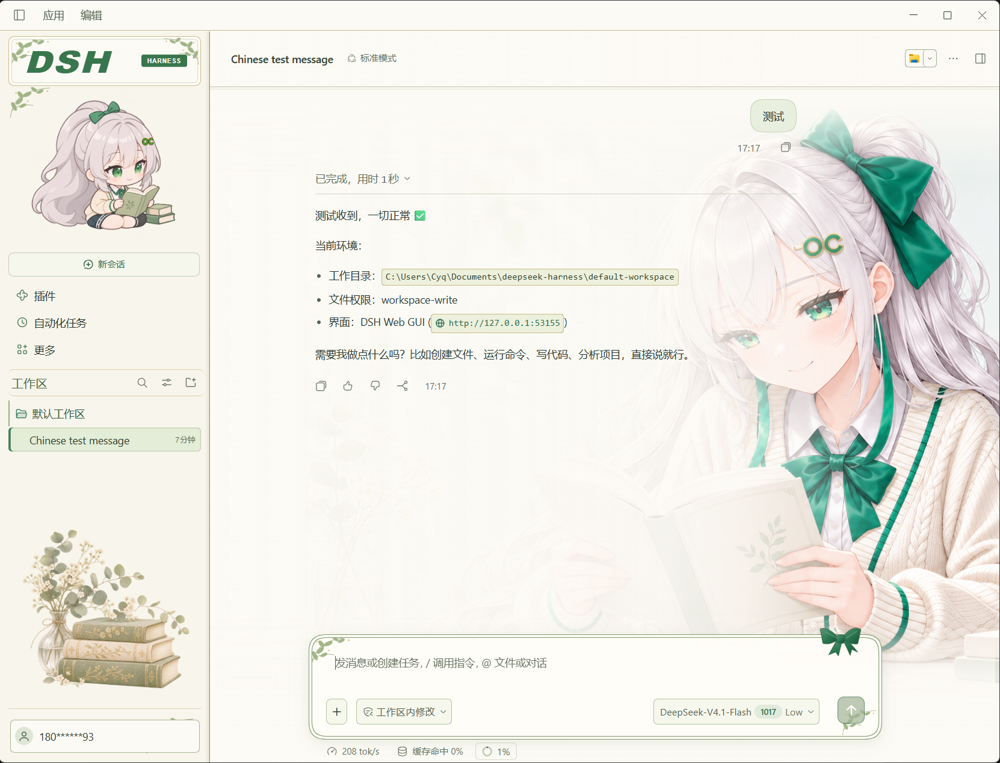
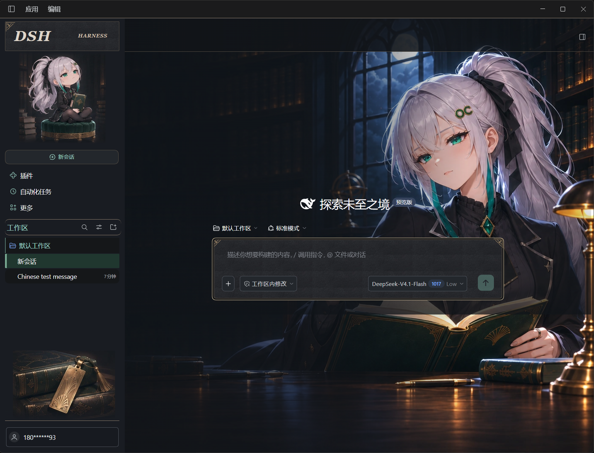
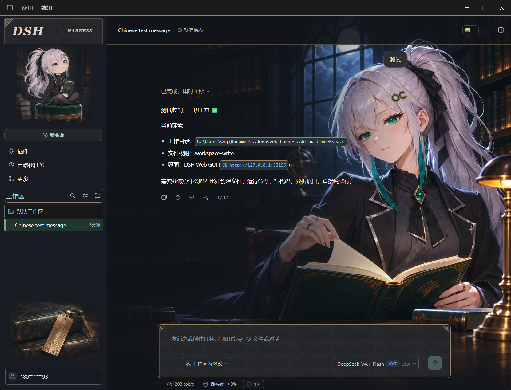

# offerContext DSH皮肤

为 **DeepSeek Harness** 制作的双主题阅读皮肤。奶白纸张、墨绿书签、OC 阅读角色与植物装饰，保留 Harness 的对话、工作区、工具和权限功能。

## 预览

以下为 Windows 桌面版实机截图。

### 浅色 · 日常阅读





### 深色 · 月下藏书室





## 安装

### DeepSeek Harness 桌面版

1. 打开 **插件 → 安装插件**。
2. 如果尚未安装皮肤管理器，先安装：

   ```text
   @smalltailqwq/dsh-client-ui-skin-deep-whale-manager
   ```

3. 在“包名或地址”中粘贴以下精简安装包地址并安装：

   ```text
   https://github.com/offercontext/dsh-offercontext-skin/releases/download/v0.3.0/offercontext-dsh-skin-reading-0.3.0.tgz
   ```

4. 安装完成后退出并重新打开 Harness。
5. 在 **设置 → 皮肤管理** 中选择 **offerContext DSH皮肤**。切换 **设置 → 外观 → 浅色 / 深色** 即可更换角色和配色。

仓库根目录就是插件包，已经包含编译好的 `lib/` 和图片资源。GitHub 安装不需要手动构建，也没有安装时执行的脚本。不要将本仓库 URL 当作 npm 包名；本插件目前通过 GitHub 分发。

桌面版的 `desktop` profile 由应用管理，请使用应用内安装入口，不要对它运行 `dsh plugin --profile desktop add`。

### Web profile

```sh
dsh plugin --profile web add '@smalltailqwq/dsh-client-ui-skin-deep-whale-manager'
dsh plugin --profile web add 'https://github.com/offercontext/dsh-offercontext-skin/releases/download/v0.3.0/offercontext-dsh-skin-reading-0.3.0.tgz'
```

重新启动对应 Web profile，再到 **设置 → 皮肤管理** 选择 **offerContext DSH皮肤**。已经安装皮肤管理器时可跳过第一条命令。Web 命令遵循 DSH 插件契约；本皮肤实机截图来自 Windows 桌面版。

### 更新与恢复

- 更新：在插件管理器中安装新版 Release 的 .tgz 地址，然后重启应用。
- 恢复：在皮肤管理里切回“官方默认”或原来的皮肤。
- 使用其他皮肤时，通过皮肤管理器互斥切换，避免同时启用多套皮肤。
- 深色外观使用暗夜 OC 娘的持书与翻书形象。选择跟随系统时，皮肤随 Harness 的实际外观切换。

## 功能与兼容性

- 在输入框点击当前模型，点模型名可更换模型，拖动滑条或按方向键可选择该模型支持的推理等级。

- 统一侧栏、顶栏、输入框、按钮、菜单、代码块、文件卡片与轮次导航的颜色和边框。
- OC 发夹的 Q 版阅读角色，以及右侧渐隐阅读插画。
- 宽表格保持在正文区域内，必要时横向滚动。
- 侧栏收起、小窗口及减少动画偏好适配；主工作区达到 1400px 时，正文和输入框恢复居中。
- 图片随包提供，通过同源白名单路由读取，不依赖外部图床或字体服务。
- 纯展示层：不改写对话内容、模型配置或权限设置。

当前版本 **0.3.0**，适配并在 **Windows / DSH 0.2.1-rc.5** 上使用。皮肤使用部分该版本的组件选择器，其他 DSH 版本或 macOS/Linux 仍需验证；升级宿主后若出现布局偏差，请附截图和版本提交 Issue。

包名：`@offercontext/dsh-skin-reading`。可选皮肤管理界面由第三方 Deep Whale Manager 提供；本插件自带独立的 `skin.json`，不包含或修改它的代码与美术资源。

## 开发

需要 Node.js 22 或更新版本；本插件没有额外运行依赖。

```sh
git clone https://github.com/offercontext/dsh-offercontext-skin.git
cd dsh-offercontext-skin
npm run build
npm test
npm pack
```

修改 `src/` 或 `assets/` 后必须执行构建，并将更新的 `lib/` 一并提交。发布包直接使用已构建产物，不依赖安装器允许执行生命周期脚本。

## 素材

阅读角色及装饰为本主题准备的图片；皮肤管理页按外观展示对应的新会话截图。README 截图中的对话内容和模型配置仅用于展示，不是插件附带的服务或配置。
